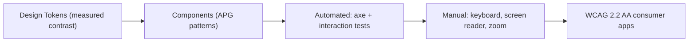
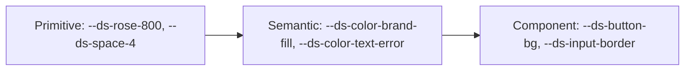
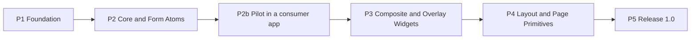

# Standalone Vue 3 Design System: Architecture & Implementation Plan

`@nftx/vue-ds` is a standalone Vue 3 + TypeScript component library with framework-agnostic design tokens. It targets **WCAG 2.2 Level AA** (AAA where noted), uses a **crimson-wine primary palette**, is mobile-first, and ships with a **Storybook 10 playground**.

> Revision 3 (2026-10-19). See §11 for the decision log and change history.
>
> This plan defines **what** is built and **when**. [IMPLEMENTATION_GUIDELINES.md](./IMPLEMENTATION_GUIDELINES.md) defines **how**; it is normative, and implementations are validated against its rule IDs.

---

## 0. Scope & Non-Goals

| In scope (v1) | Out of scope (v1) |
| :--- | :--- |
| Vue 3.5+ components (Composition API, `<script setup>`) | React / Web Components wrappers |
| Framework-agnostic tokens (`tokens.css`, SCSS) | Tailwind / utility-class framework |
| Light + Dark themes, `forced-colors`, reduced motion | Full RTL support (logical CSS properties used anyway, so RTL stays cheap later) |
| Offline-first: system font stack, bundled icons, zero CDN calls | Remote web fonts, runtime icon fetching |
| ESM library build + Storybook static site | SSR framework integration testing (components stay SSR-safe by convention) |

---

## 1. Vision & Architecture Principles

| Principle | Description |
| :--- | :--- |
| **Completely Detached** | Zero coupling to any single application. Consumers depend on a versioned package; no consumer names, paths, or service configs live in this repo. |
| **Agnostic Tokens, Vue Components** | Tokens are plain CSS custom properties usable by any stack. Components are Vue 3. |
| **WCAG 2.2 AA Baseline** | Every component meets AA. AAA is pursued where cheap and measurable (body-text contrast, focus appearance, reduced motion). Claims are backed by measured values, not assumptions. |
| **Native Platform First, No UI Library Dependencies** | Accessibility behavior comes from native HTML (`<dialog>`, `<select>`, Popover API, `inert`) plus small in-house composables (§5.3). Runtime dependencies are limited to `vue` (peer) and `lucide-vue-next` (icons). |
| **Mobile-First & Touch Ready** | Touch targets ≥ 44×44px on coarse pointers; ≥ 24×24px (SC 2.5.8) otherwise. |
| **Documented & Tested in Isolation** | Every component has Storybook stories, automated axe checks as a test gate, keyboard interaction tests, and a manual checklist (§9). |

---

## 2. WCAG 2.2 Conformance Matrix



| SC | Level | Requirement in this design system |
| :--- | :--- | :--- |
| 1.3.1 Info & Relationships | A | Semantic HTML first; labels programmatically associated (`DsField`) |
| 1.4.1 Use of Color | A | Error/success/warning always conveyed by icon + text, never color alone |
| 1.4.3 Contrast (Minimum) | AA | Text ≥ 4.5:1; large text (≥ 24px, or ≥ 18.66px bold) ≥ 3:1 |
| 1.4.6 Contrast (Enhanced) | AAA | Optional goal: body text ≥ 7:1 (brand text in light mode meets it) |
| 1.4.4 Resize Text | AA | `rem`-based type scale; respects the user's browser font size |
| 1.4.10 Reflow | AA | No horizontal scrolling at 320 CSS px width |
| 1.4.11 Non-text Contrast | AA | Input borders, checkbox/switch states, icons, focus rings ≥ 3:1 |
| 1.4.12 Text Spacing | AA | No clipping when user overrides line/letter/word spacing |
| 1.4.13 Content on Hover/Focus | AA | Popovers/menus are dismissible (Esc), hoverable, and persistent |
| 2.1.1 Keyboard | A | Every interaction reachable by keyboard; keyboard maps follow WAI-ARIA APG |
| 2.1.2 No Keyboard Trap | A | Modal focus trap always releases on close/Esc |
| 2.2.1 Timing Adjustable | A | Toasts pause on hover/focus; error toasts never auto-dismiss |
| 2.3.3 Animation from Interactions | AAA | All non-essential motion disabled under `prefers-reduced-motion` |
| 2.4.7 Focus Visible | AA | `:focus-visible` ring on every interactive element |
| 2.4.11 Focus Not Obscured (Minimum) | AA | Sticky `DsHeaderBar` uses `scroll-padding-top`; overlays don't hide focus |
| 2.4.13 Focus Appearance | AAA | Goal: 2px solid ring, 2px offset, ≥ 3:1 against adjacent colors |
| 2.5.8 Target Size (Minimum) | AA | ≥ 24×24px everywhere; ≥ 44×44px on `(pointer: coarse)` |
| 3.3.1 Error Identification | A | Errors described in text and linked via `aria-describedby` |
| 3.3.2 Labels or Instructions | A | Persistent visible labels (no placeholder-as-label, no floating labels) |
| 4.1.2 Name, Role, Value | A | Correct roles/states (`aria-expanded`, `aria-checked`, `aria-selected`, …) |
| 4.1.3 Status Messages | AA | Toast/Spinner announced through `aria-live` regions |

> [!IMPORTANT]
> Automated tools (axe-core) detect roughly a third of WCAG issues. Manual keyboard, screen reader, zoom, and forced-colors checks in §9 are mandatory, not optional.

---

## 3. Color System (Crimson-Wine Primary)

### 3.1 Why a darker brand red

A red brand collides with the universal "error = red" convention. Revision 1 used `#E11D48` as the brand and a rose/red as the error color; their measured perceptual distance was only **ΔE(OKLab) 2.7–3.8**, which makes them nearly indistinguishable. Moving the brand to a deep crimson-wine and keeping error as a true, brighter red raises the separation to **ΔE 11.8–13.8** in both themes, while lifting brand text in light mode to **AAA**.

All ratios below are measured with the WCAG 2.x relative-luminance formula and are enforced by `scripts/contrast-check.ts` (§9). White = `#FFFFFF`, light surface = `slate-50 #F8FAFC`, dark surface = `slate-900 #0F172A`.

### 3.2 Primary palette (primitive tokens)

| Token | Hex | vs white | vs slate-900 | Allowed use |
| :--- | :--- | :--- | :--- | :--- |
| `rose-50` | `#FFF1F2` | 1.10 | 16.25 | Light tint backgrounds only |
| `rose-100` | `#FFE4E6` | 1.20 | 14.87 | Light hover surfaces only |
| `rose-200` | `#FECDD3` | 1.41 | 12.66 | Dark-mode text (AAA) |
| `rose-300` | `#FDA4AF` | 1.89 | 9.44 | **Dark-mode brand text & focus ring (AAA)** |
| `rose-400` | `#FB7185` | 2.69 | 6.63 | Dark-mode hover text, dark button border |
| `rose-500` | `#F43F5E` | 3.67 | 4.86 | Decorative only (fails as text on white and as white-text fill) |
| `rose-600` | `#E11D48` | 4.70 | 3.80 | Not used for brand fills (too close to error red, ΔE 3.9) |
| `rose-700` | `#BE123C` | 6.29 | 2.84 | **Dark-mode brand fill** (white text 6.29) |
| `rose-800` | `#9F1239` | 8.02 | 2.23 | **Light-mode brand base: fill, text, focus ring (AAA)** |
| `rose-900` | `#881337` | 9.57 | 1.87 | Light-mode hover/active fill |
| `rose-950` | `#4C0519` | 15.64 | 1.14 | Dark-mode subtle brand surface |

### 3.3 Semantic role map

| Role | Light theme | Dark theme |
| :--- | :--- | :--- |
| `brand-fill` + `on-brand` text | `rose-800` + white (8.02, AAA) | `rose-700` + white (6.29, AA) + 1px `rose-400` border |
| `brand-fill-hover` | `rose-900` (9.57) | `rose-800` (8.02) |
| `brand-text` / links | `rose-800` (8.02 on white, 7.66 on slate-50) | `rose-300` (9.44) |
| `focus-ring` | `rose-800` (8.02 vs white) | `rose-300` (9.44 vs slate-900) |
| `error-text` / `error-fill` | `red-600 #DC2626` (4.83) | `red-400 #F87171` (6.45) / fill `red-600` + white (4.83) |
| `success-text` | `emerald-700 #047857` (5.48) | `emerald-500 #10B981` (7.04) |
| `warning-text` | `amber-700 #B45309` (5.02) | `amber-500 #F59E0B` (8.31) |
| `info-text` | `sky-700 #0369A1` (5.93) | `sky-500 #0EA5E9` (6.44) |
| Neutrals | Slate scale `slate-50` … `slate-950` for surfaces, borders, text | same |

Rules:
- Brand vs. error separation is measured as ΔE(OKLab): light 13.8, dark 11.8. Do not change either token without re-running the check.
- Danger actions use the **outline** style by default. A filled danger button appears only inside confirmation dialogs, so a filled brand button never sits next to a filled danger button.
- Status colors are never the only signal: every status pairs with a `lucide-vue-next` icon and text.
- Lighter shades (`500` and below on white, `600` and above on dark) are never used for text.

---

## 4. Token Architecture & Theming

### 4.1 Three tiers



- **Primitive:** raw scale values. Never referenced by components directly.
- **Semantic:** role-based. The only tier that changes per theme.
- **Component:** optional overrides scoped to one component, defaulting to semantic tokens.

### 4.2 Categories

| Category | Definition |
| :--- | :--- |
| Color | §3 primitives + semantic roles |
| Typography | System font stack (`system-ui, -apple-system, "Segoe UI", Roboto, sans-serif`), `rem` scale, line-height ≥ 1.5 for body |
| Spacing | 4px base scale (`--ds-space-1` = 0.25rem … `--ds-space-16`) |
| Radius, Shadow, Border width | Small fixed scales |
| Motion | `--ds-motion-duration-*`, `--ds-motion-easing-*`; zeroed under reduced motion |
| Z-index | Named layers: `base`, `sticky`, `overlay`, `modal`, `toast` |
| Breakpoints | **SCSS variables only**, because custom properties can't be used in media queries |

### 4.3 Cascade layers & themes

```scss
// src/styles/tokens/_semantic.scss  (Dart Sass @use, modern-compiler API)
@use 'primitives' as p;

@layer ds.tokens, ds.base, ds.components; // unlayered consumer CSS always wins

@layer ds.tokens {
  :root,
  [data-theme='light'] {
    --ds-color-brand-fill: #{p.$rose-800};
    --ds-color-text-brand: #{p.$rose-800};
    --ds-color-focus-ring: #{p.$rose-800};
    --ds-color-text-error: #{p.$red-600};
  }
  [data-theme='dark'] {
    --ds-color-brand-fill: #{p.$rose-700};
    --ds-color-text-brand: #{p.$rose-300};
    --ds-color-focus-ring: #{p.$rose-300};
    --ds-color-text-error: #{p.$red-400};
  }
  @media (prefers-color-scheme: dark) {
    :root:not([data-theme]) { /* same values as [data-theme='dark'] via shared mixin */ }
  }
  @media (prefers-reduced-motion: reduce) {
    :root { --ds-motion-duration-base: 0ms; }
  }
}

@media (forced-colors: active) {
  // focus ring -> Highlight, borders -> CanvasText, never rely on background color
}
```

- Theme selection: explicit `data-theme` attribute wins; otherwise follow `prefers-color-scheme`.
- Cascade layers let consumers override any style with plain CSS and no specificity tricks.

---

## 5. Component Conventions

### 5.1 Folder & file structure (per `.agents/rules/frontend-vue.md`)

```
src/components/DsButton/
├── DsButton.vue          # <script setup lang="ts">: props, emits, defineModel, <template src="./DsButton.html">
├── DsButton.html         # pure markup; no TypeScript `as` casts
├── DsButton.scss         # scoped styles; @use '@/styles' as ds
├── DsButton.stories.ts   # every variant/state + play() keyboard tests
├── DsButton.spec.ts      # Vitest logic tests
└── index.ts              # public export
```

- Flat `src/components/` directory. The atom/molecule/organism level is kept only as a Storybook sidebar category.
- `@/*` aliases everywhere. They must resolve in both the Vite library output and the generated `.d.ts` files (checked by the consumer smoke test, §9).
- `tsconfig.json`: `noUnusedLocals: false`, because external templates otherwise trigger false unused-import warnings.

### 5.2 API rules

- `Ds` prefix on every component (`DsButton`) to avoid clashes with native elements and other libraries.
- `defineModel()` for `v-model`; typed `defineProps` / `defineEmits`.
- Vue 3.5 `useId()` for all ARIA id wiring (SSR-safe, no random ids).
- Attribute pass-through to the semantic root element; `inheritAttrs: false` only when the root isn't the interactive element.
- No `window`/`document` access during setup (SSR-safe); DOM access only in `onMounted`.
- Icons: `lucide-vue-next` (bundled and tree-shaken). Decorative icons get `aria-hidden="true"`; icon-only buttons need an `aria-label`.

### 5.3 Accessibility behavior: native platform + in-house composables

No headless UI library is used. Complex behavior comes first from the browser, and only the remaining gaps are filled by small, single-purpose composables in `src/composables/a11y/`. Each composable is fully unit-tested (see Guidelines TEST rules).

| Behavior | Native platform feature (first choice) | In-house composable (gap filler) |
| :--- | :--- | :--- |
| Modal focus containment, background inertness, Esc | `<dialog>` + `showModal()` (top layer, `inert` outside, `cancel` event) | `useFocusReturn` (restore focus to the trigger on close) |
| Overlay layering & light dismiss (menus, toasts) | Popover API (`popover="auto"` / `"manual"`) | — |
| Overlay positioning | CSS Anchor Positioning (Baseline 2026) | `useAnchorFallback` (only when `CSS.supports('anchor-name: --a')` is false) |
| Select | Native `<select>` (styled closed state; `appearance: base-select` as progressive enhancement) | — |
| Roving tabindex (Tabs, Menu) | — | `useRovingFocus` (arrows, Home/End, wrap, orientation) |
| Menu typeahead | — | `useTypeahead` |
| Status announcements (Toast, async states) | `aria-live` regions | `useAnnouncer` (single persistent polite + assertive region) |
| ARIA id wiring | Vue 3.5 `useId()` | — |
| Scroll lock while modal open | CSS `html:has(dialog:modal) { overflow: hidden; }` + `scrollbar-gutter: stable` | — |

Rules:
- Native elements are preferred over ARIA re-implementations whenever the native element meets the requirement.
- Each composable does one thing, is framework-idiomatic (refs in, cleanup on unmount), and is documented with its keyboard/focus contract.
- Composables are internal. Exporting one publicly is a deliberate API decision recorded in §11.

```html
<!-- DsModal.html: native dialog, no library -->
<dialog
  ref="dialogRef"
  class="ds-modal"
  :class="sizeClass"
  :role="role"
  :aria-labelledby="titleId"
  :aria-describedby="description ? descriptionId : undefined"
  @cancel="onCancel"
  @close="onClose"
  @click="onBackdropClick"
>
  <component :is="headingTag" :id="titleId" class="ds-modal__title">{{ title }}</component>
  <p v-if="description" :id="descriptionId" class="ds-modal__description">{{ description }}</p>
  <slot />
</dialog>
```
(`role` is `dialog` by default and `alertdialog` for confirmations. `showModal()` / `close()` are driven by `v-model:open` in `DsModal.vue`.)

---

## 6. Component Inventory

Category is a Storybook grouping only. **MVP** = required for 1.0.

| Component | Category | Pattern / semantics | Behavior source | MVP | Phase |
| :--- | :--- | :--- | :--- | :--- | :--- |
| `DsVisuallyHidden` | Utility | Screen-reader-only content | CSS mixin | ✅ | P1 |
| `DsIcon` | Atom | Wrapper around `lucide-vue-next`, size tokens, `aria-hidden` default | Native SVG | ✅ | P2 |
| `DsButton` | Atom | Native `<button>`; variants: primary, secondary, ghost, danger (outline); loading (`aria-busy`) | Native | ✅ | P2 |
| `DsLink` | Atom | Native `<a>`; external-link indicator | Native | ✅ | P2 |
| `DsSpinner` | Atom | `role="status"` + visually hidden label | Native live region | ✅ | P2 |
| `DsBadge` | Atom | Status/count/dot; text or `aria-label` for meaning | Native | ✅ | P2 |
| `DsField` | Molecule | Label + hint + error wrapper; wires `for`, `aria-describedby`, `aria-invalid` | Native + `useId` | ✅ | P2 |
| `DsInput` | Atom | Native `<input>` (text, search, number, email); clear button; persistent label via `DsField` | Native | ✅ | P2 |
| `DsTextarea` | Atom | Native `<textarea>`; optional character count announced politely | Native + `useAnnouncer` | ✅ | P2 |
| `DsCheckbox` | Atom | Native `<input type="checkbox">`, custom visual, indeterminate | Native | ✅ | P2 |
| `DsRadioGroup` | Molecule | Native radios in `<fieldset>` + `<legend>` | Native | ✅ | P2 |
| `DsSwitch` | Atom | `<button role="switch" aria-checked>` | Native button | ✅ | P2 |
| `DsCard` | Molecule | `<article>`; whole-card link via pseudo-element; optional glass variant with opaque fallback under `prefers-reduced-transparency` / `forced-colors` | Native | ✅ | P3 |
| `DsChipGroup` | Molecule | `role="group"` of toggle buttons (`aria-pressed`) with count badges (replaces "FilterPills") | Native buttons | ✅ | P3 |
| `DsSearchBar` | Molecule | `<search>` / `role="search"` landmark + `DsInput` + hotkey hint | Native | ✅ | P3 |
| `DsSelect` | Molecule | **Native `<select>`**, styled; `appearance: base-select` progressive enhancement (replaces the "select" half of Dropdown) | Native | ✅ | P3 |
| `DsTabs` | Molecule | APG Tabs (`tablist`/`tab`/`tabpanel`), automatic or manual activation | `useRovingFocus` | ✅ | P3 |
| `DsMenu` | Molecule | APG Menu Button (replaces the "menu" half of Dropdown) | Popover API + anchor positioning + `useRovingFocus` + `useTypeahead` | ✅ | P3 |
| `DsModal` | Molecule | APG Dialog / Alert Dialog on native `<dialog>` | `showModal()` + `useFocusReturn` | ✅ | P3 |
| `DsToast` | Molecule | Live region; pause on hover/focus; errors persist until dismissed | `popover="manual"` + `useAnnouncer` | ✅ | P3 |
| `DsSkipLink` | Organism | "Skip to content" first focusable element | Native | ✅ | P4 |
| `DsHeaderBar` | Organism | `<header>` landmark, responsive nav, theme switch | Native | ✅ | P4 |
| `DsCardGrid` | Organism | Auto-fit CSS grid with gap tokens; list semantics | Native | ✅ | P4 |
| `DsEmptyState` | Organism | Icon + heading + description + action CTA | Native | ✅ | P4 |
| `DsTooltip` | Molecule | APG Tooltip; SC 1.4.13 compliant | Popover API + anchor positioning | Later | Post-1.0 |
| `DsCombobox` | Molecule | APG Combobox with filtering (searchable select) | `aria-activedescendant` composable | Later | Post-1.0 |

Removed from revision 1:
- `FocusRing` component, replaced by a global `focus-ring` SCSS mixin applied through `:focus-visible`.
- Floating labels, replaced by persistent visible labels.
- `Tag`, merged into `DsBadge` as a variant.

---

## 7. Repository, Build & Distribution

### 7.1 Layout (single package, npm)

```
nftx-vue-ds/
├── AGENTS.md                   # short pointer: agents must follow IMPLEMENTATION_GUIDELINES.md
├── IMPLEMENTATION_GUIDELINES.md# normative rules (rule IDs) used for implementation and validation
├── DESIGN_SYSTEM_PLAN.md       # this plan
├── .storybook/                 # main.ts, preview.ts (themes, a11y config)
├── src/
│   ├── components/Ds*/         # §5.1 structure
│   ├── composables/            # useReducedMotion, useTheme, …
│   │   └── a11y/               # useRovingFocus, useTypeahead, useFocusReturn, useAnnouncer, useAnchorFallback
│   ├── styles/
│   │   ├── tokens/             # _primitives.scss, _semantic.scss, _breakpoints.scss
│   │   ├── mixins/             # _focus-ring.scss, _visually-hidden.scss, _target-size.scss
│   │   ├── _base.scss          # @layer ds.base (minimal reset)
│   │   └── _index.scss         # public SCSS entry
│   ├── docs/                   # Foundations MDX (colors, typography, spacing, a11y)
│   └── index.ts                # public barrel export
├── scripts/contrast-check.ts   # fails CI if a semantic pair drops below its declared ratio
├── .env.example                # only if ever needed; real .env is git-ignored
├── package.json, vite.config.ts, vitest.config.ts, tsconfig.json
└── CHANGELOG.md
```

### 7.2 Package manifest (excerpt)

```jsonc
{
  "name": "@nftx/vue-ds",
  "type": "module",
  "sideEffects": ["**/*.css"],
  "peerDependencies": { "vue": "^3.5.0" },
  "exports": {
    ".":            { "types": "./dist/index.d.ts", "import": "./dist/index.js" },
    "./styles.css": "./dist/styles.css",   // components + tokens
    "./tokens.css": "./dist/tokens.css",   // tokens only (any stack)
    "./scss":       "./src/styles/_index.scss"
  },
  "files": ["dist", "src/styles"]
}
```

- Build: Vite library mode (ESM only) with a `.d.ts` generator (`vite-plugin-dts` or its current successor; verify at scaffold time). `vue-tsc` type-checks in CI.
- Runtime: `vue` is a `peerDependency`; `lucide-vue-next` is the only `dependency`. Any new runtime or dev dependency requires explicit approval and a decision-log entry (§11.2).
- Versioning: SemVer, with `CHANGELOG.md` updated per release and git tags `vX.Y.Z`.

### 7.3 Consumption

- **Now:** consumers install from git by tag (`"@nftx/vue-ds": "github:NFTX/nftx-vue-ds#v0.3.0"`) with a `prepare` build script. No registry infrastructure needed.
- **Later (optional):** a private npm registry if multiple consumers make git installs slow.
- Consumer usage: `import '@nftx/vue-ds/styles.css'` once, then `import { DsButton } from '@nftx/vue-ds'`.

---

## 8. Storybook 10 Playground

| Feature | Implementation |
| :--- | :--- |
| Framework | `@storybook/vue3-vite` (Storybook 10, ESM-only). Pin exact versions at scaffold time. |
| Controls, Viewport, Backgrounds | Built into Storybook core (no separate essentials addon). Viewports: 320px, mobile, tablet, desktop. |
| Theme toggle | `@storybook/addon-themes` switching `data-theme` on `<html>` (light, dark, system) |
| Accessibility | `@storybook/addon-a11y` with `parameters.a11y.test = 'error'`, so any axe violation fails the test run |
| Tests | `@storybook/addon-vitest`: stories run as Vitest browser tests (Playwright/Chromium), including `play()` keyboard interactions |
| Docs | Autodocs per component + Foundations MDX pages (palette with measured ratios, type scale, spacing, motion, keyboard maps) |
| Offline | No remote fonts or assets; the static build can be served by Nginx (`nginx:alpine`) if hosting is wanted |

---

## 9. Quality Strategy (summary)

The normative rules, coverage thresholds, Definition of Done, and validation protocol live in [IMPLEMENTATION_GUIDELINES.md](./IMPLEMENTATION_GUIDELINES.md). This section is only an overview; where they differ, the guidelines win.

| Layer | Tool | Scope | Guideline section |
| :--- | :--- | :--- | :--- |
| Static | ESLint (flat config) + `eslint-plugin-vuejs-accessibility`, `vue-tsc`, style lint | Types, template a11y lint, token-only styling | §3, §5 |
| Token | `scripts/contrast-check.ts` | Every semantic pair meets its declared ratio; brand vs. error ΔE ≥ 10; all tokens defined in every theme | §9.8 |
| Unit / component | Vitest **browser mode** + `@vue/test-utils` | Props, emits, `v-model`, slots, composables (real focus and keyboard events, no jsdom) | §9.2–§9.5 |
| Interaction + a11y | `@storybook/addon-vitest` + `addon-a11y` | Every story in both themes; keyboard contracts via `play()` | §8, §9.6 |
| Cross-browser | Same suites on Chromium, Firefox, WebKit | Behavior parity across engines | §2, §9.2 |
| Consumer smoke | Minimal Vite app importing the packed build | Exports, CSS, `.d.ts` resolution (catches unresolved `@/*` aliases) | §9.9 |
| Manual | Guideline checklist + evidence | Screen readers, zoom, forced colors, real devices | §7.15, §13 |

Coverage gates (enforced in CI): global ≥ 90% lines/statements/functions and ≥ 85% branches; `src/composables/**` at 100% lines/statements/functions and ≥ 95% branches (Guidelines §9.3).

---

## 10. Phased Roadmap & Exit Criteria



### Phase 1: Foundation, Tokens & Tooling
- [ ] Scaffold Vite + Vue 3.5 + TypeScript + Dart Sass (`modern-compiler` API) library project with `@/*` aliases.
- [ ] Implement primitive + semantic tokens (§3, §4), light/dark/system themes, `forced-colors`, and reduced motion.
- [ ] Add mixins: `focus-ring`, `visually-hidden`, `target-size`. Add `DsVisuallyHidden`.
- [ ] Set up Storybook 10 (`addon-a11y` as gate, `addon-themes`, `addon-vitest`) and Foundations MDX pages.
- [ ] Add `scripts/contrast-check.ts`, ESLint + vue-a11y plugin, `vue-tsc`, and the CI pipeline (Guidelines §11).
- **Exit:** all CI gates green; Foundations docs show measured ratios matching §3.

### Phase 2: Core & Form Atoms
- [ ] `DsIcon`, `DsButton`, `DsLink`, `DsSpinner`, `DsBadge`.
- [ ] `DsField`, `DsInput`, `DsTextarea`, `DsCheckbox`, `DsRadioGroup`, `DsSwitch`.
- **Exit:** every component meets the Definition of Done (Guidelines §10).

### Phase 2b: Pilot Integration
- [ ] Tag `v0.x`, install into one real consumer app via git tag, and replace one screen's custom CSS with tokens + `DsButton` + `DsField`.
- [ ] Record API friction and fix it before building composites.
- **Exit:** pilot screen ships with no regressions; API adjustments are merged.

### Phase 3: Composite & Overlay Widgets
- [ ] Build and unit-test a11y composables (`useRovingFocus`, `useTypeahead`, `useFocusReturn`, `useAnnouncer`, `useAnchorFallback`) to 100% line/statement/function coverage.
- [ ] `DsCard`, `DsChipGroup`, `DsSearchBar`, `DsSelect` (native semantics).
- [ ] `DsTabs`, `DsMenu`, `DsModal`, `DsToast` (native `<dialog>` / Popover API + a11y composables, §5.3).
- **Exit:** Definition of Done met; keyboard maps documented and covered by `play()` tests across Chromium, Firefox, and WebKit.

### Phase 4: Layout & Page Primitives
- [ ] `DsSkipLink`, `DsHeaderBar` (with theme switch, `scroll-padding-top`), `DsCardGrid`, `DsEmptyState`.
- [ ] Responsive audit: 320px reflow, coarse-pointer target sizes across all components.
- **Exit:** a full demo page in Storybook passes axe plus the manual checklist at all viewports.

### Phase 5: Release 1.0
- [ ] Finalize exports map, `.d.ts` output, `CHANGELOG.md`, and `v1.0.0` tag.
- [ ] Complete migration of the pilot consumer app.
- [ ] Optional: publish the static Storybook via an `nginx:alpine` container.
- **Exit:** consumer smoke test passes from a clean install; no open a11y defects.

---

## 11. Risks, Decisions & Revision History

### 11.1 Risks

| Risk | Mitigation |
| :--- | :--- |
| Hand-rolled focus/roving-tabindex edge cases | Prefer native `<dialog>`, `<select>`, and Popover API first; isolate remaining gaps in small composables tested in real browsers (Chromium, Firefox, WebKit) at 100% coverage |
| `@/*` aliases leak into published `.d.ts` | Consumer smoke test in CI (Guidelines §9.9) |
| External `.html` templates reduce IDE type-checking coverage | `vue-tsc` in CI; keep template logic minimal |
| Token drift breaks contrast | `contrast-check.ts` gate on every PR |
| Over-scoping before real usage | Phase 2b pilot validates the API early |

### 11.2 Decision log

| ID | Decision | Rationale |
| :- | :--- | :--- |
| D1 | Zero headless UI library dependencies; use native HTML (`<dialog>`, `<select>`, Popover API, CSS Anchor Positioning) + small in-house composables | Full control, zero third-party UI lock-in, smaller bundle, aligned with learning and long-term maintainability |
| D2 | WCAG 2.2 AA baseline, selective AAA | Measurable, honest conformance claims |
| D3 | Brand moved to crimson-wine (`rose-800` light / `rose-700` fill + `rose-300` text dark); error stays true red (`red-600` / `red-400`) | Brand vs. error ΔE rose from 2.7–3.8 to 11.8–13.8; brand text becomes AAA in light mode |
| D4 | Package name `@nftx/vue-ds` | Matches repository; generic, no environment-specific naming |
| D5 | Distribution by git tag; registry later if needed | Zero infrastructure |
| D6 | Single package with subpath exports (`tokens.css`, `scss`) | KISS; tokens still consumable by non-Vue stacks |
| D7 | Flat `components/` folder; atomic level only in Storybook | Simpler imports and discoverability |
| D8 | npm as package manager | No new tooling |

### 11.3 Revision history

| Rev | Date | Summary |
| :- | :--- | :--- |
| 1 | 2026-08 | Initial plan (Storybook 8, `#E11D48` brand, atomic folders) |
| 2 | 2026-10-18 | Measured-contrast palette rework; brand/error separation; corrected WCAG matrix; Storybook 10; Reka `asChild` policy; reconciled inventory; testing & DoD; distribution model; exit criteria |
| 3 | 2026-10-19 | Removed Reka UI dependency in favor of native platform primitives (`<dialog>`, `<select>`, Popover API, CSS Anchor Positioning) + in-house a11y composables; extracted normative rules and validation protocol into `IMPLEMENTATION_GUIDELINES.md` |
