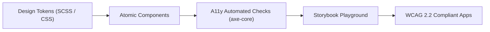

# 🎨 Standalone Vue 3 Design System: Architecture & Implementation Plan

A decoupled, framework-agnostic design system and reusable Vue 3 + TypeScript component library built to comply with **WCAG 2.2 Level AA / AAA**, featuring a **primary Red palette**, mobile-first responsiveness, and an interactive **Storybook Playground**.

---

## 📌 1. Vision & Architecture Principles

| Principle | Description |
| :--- | :--- |
| **Completely Detached** | Zero coupling to any single application; publishable as an independent package (`@homelab/ui` or similar) or consumable via workspace packages. |
| **WCAG 2.2 First** | Built from the ground up to meet and exceed [W3C WCAG 2.2](https://www.w3.org/TR/WCAG22/) standards (contrast, focus indicators, target size minimums, keyboard accessibility). |
| **Red Primary Palette** | A sophisticated Crimson / Ruby Red core palette engineered for optimal contrast in both dark and light modes. |
| **Mobile-First & Touch Ready** | Minimum 44×44px touch targets on mobile (exceeding WCAG 2.2 SC 2.5.8 24×24px requirement) with responsive layout primitives. |
| **Storybook & Interactive Playground** | Every component features isolated documentation, live props controls, viewport testing, and automated axe-core accessibility audits. |

---

## ♿ 2. WCAG 2.2 Compliance Matrix



### Key WCAG 2.2 Success Criteria Addressed:

1. **SC 1.4.3 & 1.4.6 Contrast (Minimum & Enhanced):**
   - Normal text: $\ge 4.5:1$ (AA) / $\ge 7:1$ (AAA).
   - Large text ($\ge 18\text{pt}$ / $24\text{px}$): $\ge 3:1$ (AA) / $\ge 4.5:1$ (AAA).
2. **SC 1.4.11 Non-Text Contrast ($\ge 3:1$):**
   - Visual boundaries of input fields, checkboxes, switches, button borders, and icons.
3. **SC 2.4.11 & 2.4.13 Focus Appearance & Not Obscured:**
   - Universal 2px high-contrast focus rings (`outline: 2px solid var(--ds-focus-ring); outline-offset: 2px;`) that are never hidden on keyboard navigation (`:focus-visible`).
4. **SC 2.5.8 Target Size (Minimum 24×24px, 44×44px recommended on mobile):**
   - All interactive controls (buttons, chips, checkboxes, close icons) provide sufficient hit area without overlap.
5. **SC 4.1.2 Name, Role, Value & ARIA Semantics:**
   - Full WAI-ARIA attributes (`aria-expanded`, `aria-controls`, `aria-label`, `aria-describedby`, `role="dialog"`).

---

## 🔴 3. Color System & Design Tokens (Red Primary)

The primary palette uses a balanced Crimson Red scale designed to maintain high readability across both dark and light surfaces.

### Primary Red Palette

| Token | Hex | Dark Mode Role | Light Mode Role | Contrast Compliance |
| :--- | :--- | :--- | :--- | :--- |
| `primary-50` | `#FFF1F2` | Subtle Tint / Glow | Light Card Background | — |
| `primary-100` | `#FFE4E6` | Muted Border | Surface Hover | — |
| `primary-200` | `#FECDD3` | Accent Text on Dark | Active Border | $\ge 4.5:1$ on dark |
| `primary-400` | `#FB7185` | Hover on Dark | Secondary Accent | $\ge 4.5:1$ on dark |
| `primary-500` | `#F43F5E` | **Primary Brand (Dark)** | Active State | $\ge 4.5:1$ on dark |
| `primary-600` | `#E11D48` | Glow / Hover | **Primary Brand (Light)** | $\ge 4.5:1$ on light |
| `primary-700` | `#BE123C` | Active State | Dark Accent | $\ge 7:1$ on light (AAA) |
| `primary-800` | `#9F1239` | High Contrast Text | High Contrast Text | $\ge 7:1$ on light (AAA) |
| `primary-900` | `#881337` | Base Tint | Ultra-Dark Text | $\ge 7:1$ on light (AAA) |

### Semantic System Tokens
- **Neutral:** Slate / Zinc (`slate-50` to `slate-950`) for backgrounds, borders, and typography.
- **Success:** Emerald (`#10B981` / `#059669`)
- **Warning:** Amber (`#F59E0B` / `#D97706`)
- **Error:** Rose (`#F43F5E` / `#E11D48`)
- **Info:** Sky / Blue (`#0EA5E9` / `#0284C7`)

---

## 📦 4. Component Scope & Breakdown

```
design-system/
├── tokens/                     # CSS Custom Properties & SCSS tokens (colors, spacing, shadows)
├── atoms/
│   ├── Button/                 # Primary, Secondary, Ghost, Danger, Outline (44px touch target)
│   ├── Badge/                  # Status, Tag, Count, Indicator dot
│   ├── Icon/                   # Standardized vector icon system with sizing tokens
│   ├── Input/                  # Text, Search, Number with clear button and floating labels
│   ├── Checkbox/               # Custom accessible checkbox with keyboard navigation
│   ├── Switch/                 # Accessible toggle switch (role="switch", aria-checked)
│   ├── Spinner/                # Accessible animated loading indicator (aria-live="polite")
│   └── FocusRing/              # Reusable WCAG 2.2 compliant focus wrapper
├── molecules/
│   ├── Card/                   # Interactive card, Glassmorphism card, Action card
│   ├── SearchBar/              # Search input with clear button, hotkey indicator, dropdown
│   ├── Modal/                  # Accessible dialog with focus trap, Esc key, backdrop blur
│   ├── Toast/                  # Accessible alert toast notifications with timer progress
│   ├── Dropdown/               # Accessible select/menu with arrow key navigation
│   └── TabGroup/               # Accessible tab navigation (role="tablist", aria-selected)
└── organisms/
    ├── HeaderBar/              # Responsive navigation header with theme switch
    ├── CardGrid/               # Responsive auto-fit CSS grid with gap tokens
    └── EmptyState/             # Illustrated empty results placeholder with action CTA
```

---

## 🧪 5. Storybook & Playground Setup

1. **Interactive Controls:** Every component story includes knobs/controls for all props, slots, and events.
2. **A11y Addon (`@storybook/addon-a11y`):** Real-time automated audit tab in Storybook displaying pass/fail results based on `axe-core`.
3. **Viewport Addon:** Quick switching between Mobile (iPhone, Pixel), Tablet (iPad), and Desktop viewports.
4. **Theme Addon:** One-click toggle between Dark and Light mode to verify contrast tokens instantly.

---

## 🗺️ 6. Phased Implementation Roadmap

### Phase 1: Foundation, Tokens & Tooling
- [ ] Initialize repository structure (`packages/design-system` or standalone repo).
- [ ] Configure Vite + Vue 3 + TypeScript + Sass.
- [ ] Create design tokens (CSS custom properties, SCSS variables, Red primary palette, Dark/Light modes).
- [ ] Set up Storybook 8 with `@storybook/addon-a11y` and viewport controls.

### Phase 2: Core Atoms
- [ ] Implement `Button` (with WCAG 2.2 focus ring, loading state, 44px mobile touch target).
- [ ] Implement `Badge` & `Tag` components.
- [ ] Implement `Input` & `SearchBar` with accessible labels, errors, and clear buttons.
- [ ] Implement `Switch` and `Checkbox` with WAI-ARIA keyboard navigation.
- [ ] Write Storybook stories and a11y tests for all atoms.

### Phase 3: Molecules & Accessibility Audits
- [ ] Implement `Card` (responsive elevation, focusable, keyboard accessible).
- [ ] Implement `Modal` with focus trap and screen reader announcements.
- [ ] Implement `TabGroup` and `FilterPills` with count badges.
- [ ] Run full automated `axe-core` accessibility test suite.

### Phase 4: Organisms & Mobile Optimization
- [ ] Implement `HeaderBar` and `CardGrid` layout primitives.
- [ ] Implement `Toast` / notification system.
- [ ] Optimize touch targets and responsive breakpoints for mobile screens.

### Phase 5: Distribution & Integration
- [ ] Configure `vite-plugin-dts` to export TypeScript declaration files (`.d.ts`).
- [ ] Set up package exports (`@homelab/ui`) for tree-shaking.
- [ ] Create example integration in `Portal` replacing custom CSS with design system tokens and components.
